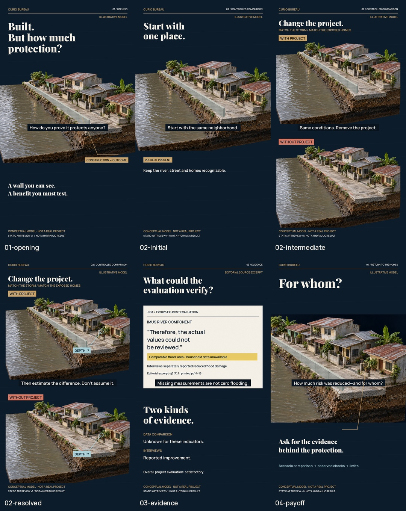

# Flood-control proof — actual art review v1

Owner-selected episode: **How do you prove a flood-control project actually protects anyone?**

## Connected demanding passage

[Initial: one place](review/02-initial.png) → [Intermediate: project alternatives](review/02-intermediate.png) → [Resolved: same home entrance sampled](review/02-resolved.png).

[Heading-hidden proof](review/02-resolved-heading-hidden.png) keeps necessary labels. Other compositions: [opening](review/01-opening.png), [evidence excerpt](review/03-evidence.png), [return to the homes](review/04-payoff.png).

[Narration draft](../brief/NARRATIVE.md) · [Sources/limits](../research/CLAIMS_AND_SOURCES.md) · [Owner selection](../brief/OWNER_SELECTION.md) · [Sequence and review](REVIEW.md) · [Frame hashes](RENDER_RECEIPT.json) · [Production status](../PRODUCTION_STATUS.json)

Status: static art ready for owner review. Natural Bernard, word-aligned captions, motion, temporal focus hunts, original score, selected SFX, listening and complete encoded film remain pending. No movie has been rendered. Your selected topic supersedes the earlier no-selection checkpoint; previous candidates are historical.

The generated neighborhood is a labeled conceptual illustration. The separately constructed wall changes only one comparison case; the same home entrance is sampled in both. Unknown depth remains unknown. No hydraulic simulation, real project or measured protection result is depicted.

Rebuild with Python/Pillow/numpy/scipy and pinned repository fonts using render_review.py. Existing opening is an archived input; renderer builds the other six PNGs and board. It is a static-review compositor, not an animation engine.

Generation prompt, original/native-component distinctions and font settings are recorded in [asset provenance](ASSET_PROVENANCE.json). [Public download QA](PUBLIC_DOWNLOAD_QA.json) verified all eight review image byte counts and SHA-256 hashes against the rendered receipt; this verifies archival integrity only.
