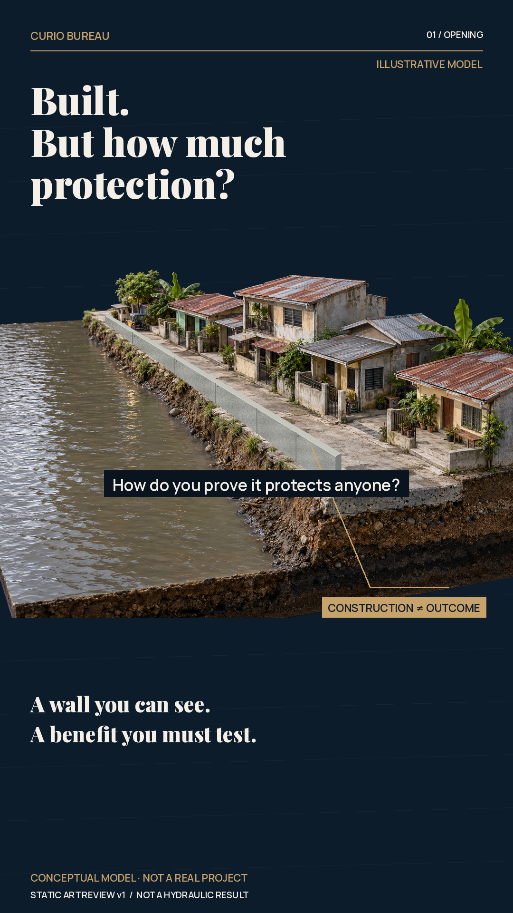

# Flood-control proof — art review checkpoint

Owner-selected episode. Actual saved opening and independently addressable components:

[Original conceptual scenery](assets/neighborhood-concept-v1.png) · [Masked scenery](assets/neighborhood-masked.png) · [Independent wall](assets/wall-component.png)

[Narration draft](../brief/NARRATIVE.md) · [Sources and limits](../research/CLAIMS_AND_SOURCES.md) · [Owner selection](../brief/OWNER_SELECTION.md)

Status: static art review; voice, aligned captions, motion, sound, actual focus hunts and final film NOT STARTED. Owner art approval pending. Other previously rendered review states are being recovered; do not claim all are archived at this checkpoint. No movie rendered.

Scene design: same neighborhood → registered with/without-project pair → remove wall from only one case → select identical doorway. Preserve storm/asset comparability; leave depth unknown rather than inventing protection. Bring comparison into the opening sequence rather than holding while captions alone advance. Then actual evidence inspection and return to homes. Actual voice will set times.

The conceptual model's roofs, plaster, soil and water retain material identity; the wall is a separate native component with its own texture/seams. No false parallax claim: deeper camera moves need additional separation and repaired hidden regions. Temporal finishing must be checked in actual encoded phone playback; static texture is not that pass.

Required art gate: [VISUAL_TRANSLATION_REVIEW.md](../../../art-direction/VISUAL_TRANSLATION_REVIEW.md): “Only recorded approval of this actual version permits animation.” Moving and whole-film approval remain separate.
